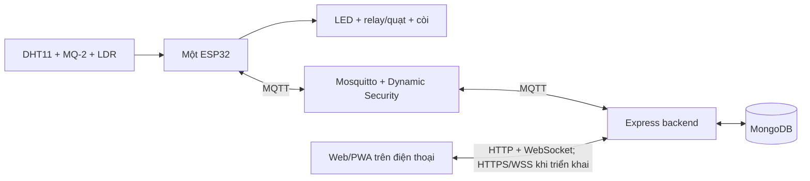

# Bàn giao và ghép một ESP32 với NODO

**Phạm vi demo:** một ESP32. Firmware đã nhận có DHT11 + MQ-2 + LDR, LED/quạt/còi; còn lệch topic/JSON và cần profile BE gộp. Hiện dùng `hw-climate-01` để kiểm thử climate bằng MQTTX; phần lighting/hai board trong các ví dụ mở rộng không bắt buộc. Chi tiết [review firmware](../firmware/REVIEW.md) và [trạng thái hiện tại](CURRENT-STATUS.md).

Làm buổi đầu trong cùng một Wi-Fi/LAN, ghép được từng đoạn rồi mới thử từ xa. Repo này chứa backend/web/PWA; hai bạn phần cứng viết và nạp firmware riêng cho ESP32. Backend nhận dữ liệu bằng MQTT, không có API HTTP để board POST telemetry.

## 1. Sơ đồ và phân công



| Người | Việc cần chuẩn bị |
| --- | --- |
| BE | Atlas/database, chạy Express, cấu hình broker và service account, đăng ký/provision/kích hoạt node, quyền nhà/user, kiểm tra DB/audit/command |
| Phần cứng 1 | ESP32 climate, DHT, driver quạt/còi, Auto/Manual, MQTT/ACK/heartbeat/reconnect/NVS |
| Phần cứng 2 | ESP32 lighting, LDR, LED/driver, map ADC → % sáng, các hành vi MQTT tương tự |
| Người phụ trách FE/demo | Web/PWA, tài khoản operator/viewer, ghi màn hình và bảng kết quả; phối hợp quan sát đầu ra thật |

Mosquitto là **broker**, MQTT Explorer nếu dùng là công cụ xem/gửi bản tin. Giao diện người dùng nằm ở NODO `/app`. Node không cần biết home_id/room_id: operator xếp phòng trên app, BE lưu quan hệ với Device ID.

## 2. Thông tin phải bàn giao cho mỗi board

| Trường | Climate | Lighting |
| --- | --- | --- |
| Device ID | `hw-climate-01` | `hw-light-01` |
| Profile đăng ký trên web | `climate` | `lighting` |
| MQTT clientId | `hw-climate-01` | `hw-light-01` |
| MQTT username | `hw-climate-01` | `hw-light-01` |
| MQTT password | Mật khẩu ngẫu nhiên admin nhận khi provision | Mật khẩu ngẫu nhiên riêng của node này |
| Host broker | IP LAN máy chạy Mosquitto, ví dụ `192.168.1.10` | Cùng broker |
| Port lab | `1884` trong cấu hình mẫu dưới đây | `1884` |
| Topic prefix | `smartroom` | `smartroom` |
| Wi-Fi | SSID/password mạng board kết nối được | Cùng mạng trong buổi ghép đầu |

Host trong firmware là IP/domain, không phải URL web `http://.../app`. Trên ESP32, `127.0.0.1` trỏ về chính ESP32, không trỏ về laptop. Tài khoản web operator/viewer, tài khoản Atlas, tài khoản MQTT backend và credential MQTT của node là các thông tin khác nhau. Chỉ nạp credential của chính node vào board, không nạp `.env` backend.

Username + password + clientId của node đều phải khớp: backend provision ràng buộc clientId bằng Device ID. Hai board dùng chung clientId có thể làm ngắt kết nối lẫn nhau.

## 3. Kiểm tra backend trước

Từ thư mục `iot-admin`:

```powershell
npm.cmd install
npm.cmd run db:check
```

Phải thấy kiểm tra MongoDB thành công rồi mới ghép phần cứng. Lần kiểm tra trước của dự án gặp TLS khi tới Atlas; đây là việc cần kiểm tra lại (IP Access List, đường mạng/TLS), không sửa bằng cách tắt xác minh chứng chỉ. MongoDB Atlas không thay thế MQTT broker.

Nên dùng database lab riêng, ví dụ `MONGODB_DB_NAME=iot_hardware_lab`, để các ca lỗi/thu hồi không ảnh hưởng dữ liệu demo đang có. Database mới ngoài demo cần `ADMIN_EMAIL`, `ADMIN_PASSWORD` tối thiểu 12 ký tự để bootstrap và `SESSION_SECRET` ngẫu nhiên tối thiểu 32 ký tự. User mới sau đó tạo bằng web hoặc đăng ký operator/viewer.

Không xóa database đang dùng. Không coi hai node demo có sẵn là tài khoản đã được tạo trên Mosquitto; việc tắt demo không tự provision credential thật cho chúng.

## 4. Broker lab trên Windows

Adapter hiện có dùng API điều khiển **Mosquitto Dynamic Security** để provision, khóa và mở node. Broker MQTT thông thường không có plugin này vẫn chưa đủ cho luồng vòng đời hiện tại. `MQTT_DYNAMIC_SECURITY=false` không phải chế độ tự bỏ qua kiểm tra khi nhấn provision/khóa/kích hoạt.

### 4.1. Khởi tạo lần đầu

Cài bản Mosquitto có `mosquitto.exe`, `mosquitto_ctrl.exe` và `mosquitto_dynamic_security.dll` từ [trang tải chính thức](https://mosquitto.org/download/). Kiểm tra đúng thư mục cài đặt; ví dụ bên dưới dùng `C:\Program Files\mosquitto`.

PowerShell ở gốc repo:

```powershell
$labMosquittoRoot = 'C:\Program Files\mosquitto'
$labBrokerWork = Join-Path (Get-Location) '.artifacts\mosquitto-lab'
New-Item -ItemType Directory -Force -Path $labBrokerWork | Out-Null
Test-Path (Join-Path $labMosquittoRoot 'mosquitto_dynamic_security.dll')
```

Nếu plugin không tồn tại, xác định bản cài/plugin trước khi tiếp tục. Tạo file Dynamic Security **một lần** khi chưa có file này:

```powershell
& (Join-Path $labMosquittoRoot 'mosquitto_ctrl.exe') dynsec init (Join-Path $labBrokerWork 'dynamic-security.json') lab-admin
Copy-Item deployment/mosquitto-lab.conf.example (Join-Path $labBrokerWork 'mosquitto.conf')
```

Lệnh init hỏi mật khẩu của `lab-admin` trong terminal, không cần đưa mật khẩu vào command history. File JSON này chứa cấu hình quyền/credential broker; giữ file để restart, không init/ghi đè lại mỗi lần chạy. `.artifacts/` đã được Git bỏ qua.

Mở `.artifacts/mosquitto-lab/mosquitto.conf`, thay hai đường dẫn placeholder bằng đường dẫn tuyệt đối thật. Ví dụ dạng cấu hình:

```conf
per_listener_settings false
listener 1884
allow_anonymous false
plugin C:\Program Files\mosquitto\mosquitto_dynamic_security.dll
plugin_opt_config_file C:\DUONG_DAN_REPO\iot-admin\.artifacts\mosquitto-lab\dynamic-security.json
log_type error
log_type warning
log_type notice
log_type information
```

`DUONG_DAN_REPO` là chỗ phải thay, không phải đường dẫn có sẵn. Tiến trình chạy broker cần quyền ghi file Dynamic Security để lưu các node mới. Chạy foreground trong terminal lab:

```powershell
& (Join-Path $labMosquittoRoot 'mosquitto.exe') -c (Join-Path $labBrokerWork 'mosquitto.conf') -v
```

Nếu port 1884 đã có broker/service khác sử dụng, dùng broker đó với cấu hình đúng hoặc chọn port lab khác và đổi đồng nhất cho BE/ESP32. Không chạy nhầm hai broker khác nhau. Listener 1884 ở mẫu này là MQTT chưa mã hóa, chỉ dành cho LAN thử nghiệm; không publish nó ra Internet.

### 4.2. Tạo account riêng cho backend

Mở terminal thứ hai, vẫn ở repo, đặt biến đường dẫn một lần nữa. Người quản trị broker thực hiện các lệnh sau; mỗi lệnh yêu cầu mật khẩu `lab-admin` khi cần:

```powershell
$labMosquittoRoot = 'C:\Program Files\mosquitto'
$labCtrlExe = Join-Path $labMosquittoRoot 'mosquitto_ctrl.exe'
& $labCtrlExe -h 127.0.0.1 -p 1884 -u lab-admin dynsec createClient nodo-backend
& $labCtrlExe -h 127.0.0.1 -p 1884 -u lab-admin dynsec addClientRole nodo-backend admin 10
& $labCtrlExe -h 127.0.0.1 -p 1884 -u lab-admin dynsec createRole nodo-backend-publish
& $labCtrlExe -h 127.0.0.1 -p 1884 -u lab-admin dynsec addRoleACL nodo-backend-publish publishClientSend 'smartroom/#' allow 10
& $labCtrlExe -h 127.0.0.1 -p 1884 -u lab-admin dynsec addClientRole nodo-backend nodo-backend-publish 10
```

`createClient` hỏi mật khẩu mới của `nodo-backend` trước mật khẩu admin: đọc đúng prompt. Không gán clientId cố định cho account backend vì code tạo clientId dạng `nodo-backend-<uuid>` mỗi lần khởi động.

Role `admin` do init tạo cho phép quản lý Dynamic Security và đọc các topic, nhưng **không tự có quyền publish topic ứng dụng**. Vì vậy cần role publish bổ sung trên; nếu thiếu bước này có thể đọc số đo nhưng không điều khiển được. Các role rộng này chỉ gán cho service backend được tin cậy, không gán cho board.

Đây là quy trình setup cần chạy trên Mosquitto thật; repo chưa chạy các lệnh này thay nhóm. Nếu tạo dở rồi chạy lại gặp Already exists, kiểm tra client/role đã có, không xóa toàn bộ broker JSON để xử lý.

### 4.3. Cấu hình Express

Trong `.env` riêng, giữ MongoDB URI hợp lệ và đặt:

```dotenv
DEMO_MODE=false
MQTT_URL=mqtt://127.0.0.1:1884
MQTT_USERNAME=nodo-backend
MQTT_PASSWORD=MAT_KHAU_BACKEND_VUA_TAO
MQTT_TOPIC_PREFIX=smartroom
MQTT_DYNAMIC_SECURITY=true
NODE_ENV=development
TRUST_PROXY=0
```

Ví dụ trên giả định broker và BE cùng laptop. Nếu khác máy, thay host bằng IP/domain máy broker. `MAT_KHAU_BACKEND_VUA_TAO` phải thay bằng secret thật; không copy nguyên placeholder. Không ghi đè các biến Atlas/session/admin còn lại.

Chạy:

```powershell
npm.cmd run dev:lan
```

Admin mở `http://127.0.0.1:3080`; kiểm tra trang Cài đặt báo broker kết nối thật và demo tắt. `DEMO_MODE=false` nghĩa là firmware phải tạo số đo/ACK, backend không giả lập hộ nữa. Sau sửa `.env`, restart tiến trình Node để nạp lại.

Điện thoại cùng Wi-Fi mở `http://<IP-LAN-laptop>:3080/app`. Dùng `ipconfig` để xem đúng IPv4 của card mạng đang nối Wi-Fi. Khi bị chặn, kiểm tra firewall cho TCP 3080 (web) và TCP 1884 (MQTT) trong mạng lab. `Test-NetConnection <IP-broker> -Port 1884` chỉ xác minh TCP, chưa chứng minh MQTT auth/ACL đúng.

## 5. Đăng ký, provision và bàn giao node

Thực hiện lần lượt mỗi board, không lấy credential của board này dùng cho board kia:

1. Đăng nhập admin → Thiết bị → Đăng ký. ID `hw-climate-01`, profile climate; node thứ hai `hw-light-01`, profile lighting. Để **kho/chưa vào nhà**, người phụ trách chưa gán; chưa chia sẻ viewer riêng.
2. Chi tiết node → Cấp quyền kết nối. Chỉ tiếp tục nếu broker xác nhận thật, không có `simulated:true`. Ghi lại username/clientId/password một lần để giao riêng cho người nạp board. DB không lưu plaintext mật khẩu node để xem lại.
3. Đóng rồi mở lại chi tiết node → Tạo mã nhận thiết bị. Mã này dùng trên web, hạn 24 giờ; **khác mật khẩu MQTT**.
4. Operator đăng ký/đăng nhập → tạo Nhà A → tạo phòng → Thiết bị → Nhận thiết bị. Nhập Device ID + mã claim + phòng. Đây là bước quyền sở hữu trong hệ thống.
5. Admin kích hoạt node sang active. Khi đó mới nhận telemetry/control. Firmware đang phát vào node registered/provisioned/locked sẽ không được BE coi là hoạt động hợp lệ.
6. Hai bạn phần cứng điền thông tin được bàn giao vào cấu hình firmware riêng, nạp board và mở Serial Monitor.

Nếu provision bị gián đoạn sau khi broker đã tạo một phần role/client, backend hiện chưa rollback nhiều bước tự động. Người BE đối chiếu DB và broker trước khi thử lại; không bỏ qua lỗi hoặc tuyên bố node đã provision thành công.

## 6. Firmware tối thiểu phải làm

Chốt chân GPIO/mạch theo board thật; quạt/relay dùng driver/nguồn phù hợp, GPIO là tín hiệu điều khiển. Không có chức năng cửa/servo trong dự án này.

```text
BOOT
  đọc cấu hình đã lưu, tạo bootId mới, seq=0
  kết nối Wi-Fi, đồng bộ giờ NTP
  đặt LWT rồi CONNECT MQTT bằng đúng clientId/username/password
  subscribe command và config của chính node
  publish status online, firmware version và fault hiện tại

LOOP không chặn xử lý MQTT
  đọc cảm biến theo chu kỳ phù hợp, kiểm tra lỗi
  nếu AUTO: đánh giá ngưỡng tại node và cập nhật đầu ra
  khoảng 4 giây: publish telemetry thật, seq tăng mỗi gói mới
  mỗi 10 giây: heartbeat status
  khi nhận command/config: kiểm tra ID, mode, expiresAt và trùng commandId
    áp dụng đầu ra / lưu config NVS, rồi publish application ACK
  khi mất mạng: Auto tại node tiếp tục; reconnect có backoff và subscribe lại
```

Auto → Manual giữ trạng thái đầu ra đến khi có lệnh mới; Manual → Auto đánh giá lại số đo hiện tại. Mỗi node chỉ có một mode chung. Không tự động chỉnh ngưỡng theo dữ liệu; ngưỡng do operator cấu hình. Cảnh báo trên BE vẫn hoạt động ở cả hai mode nếu còn nhận dữ liệu.

Giữ NVS cho config/mode; chỉ ghi flash khi cấu hình thay đổi, không ghi lại mỗi lần đọc cảm biến. Nếu chưa đồng bộ được thời gian, không gửi timestamp 1970 hoặc nhận lệnh hết hạn như lệnh mới. Có thể trả ACK failed với message nêu lỗi đồng hồ cho lệnh nhận được.

Serial nên ghi: Device ID, kết nối Wi-Fi/MQTT, bootId/seq, số đo, topic, commandId, thay đổi GPIO/mode và kết quả ACK. Không in mật khẩu Wi-Fi/MQTT vào log quay demo. Firmware có secret cần được loại khỏi Git của nhóm.

### Chú ý thư viện MQTT

Nếu đã dùng PubSubClient: thư viện này chỉ publish QoS 0, dù subscribe được QoS 1; packet buffer mặc định nhỏ. Cần kiểm tra `setBufferSize(1024)` hoặc kích thước đủ cho topic + JSON + header, callback đúng payload length và gọi xử lý MQTT thường xuyên. Nếu bài test yêu cầu publish QoS 1 cho ACK/status thì chọn thư viện hỗ trợ thực sự, ghi QoS đã dùng vào báo cáo. Không ghi báo cáo QoS 1 chỉ vì BE subscribe QoS 1.

## 7. Topic/JSON phải khớp code

Với `hw-climate-01`:

| Chiều | Topic |
| --- | --- |
| ESP32 → BE | `smartroom/hw-climate-01/telemetry` |
| ESP32 → BE | `smartroom/hw-climate-01/status` |
| ESP32 → BE | `smartroom/hw-climate-01/ack` |
| BE → ESP32 | `smartroom/hw-climate-01/command` |
| BE → ESP32 | `smartroom/hw-climate-01/config` |

Node lighting thay Device ID bằng `hw-light-01`. Topic không chứa home_id/room_id. Command/config không retained. Status online/LWT retained; telemetry/ack không retained. LWT payload là `{"online":false}` trên status của chính node và phải cấu hình trước CONNECT.

Payload và ví dụ đầy đủ: [MQTT-CONTRACT.md](MQTT-CONTRACT.md). JSON strict: không tự thêm key ngoài hợp đồng. Các lỗi hay gặp:

- Phải dùng `temperature`, `humidity`, `lightPercent`; không đổi thành temp/hum/light.
- Trong MQTT là `lightPercent`; trong response DB/API lịch sử có `light_percent`.
- Boolean là true/false, không phải chuỗi "true" hay số 1/0.
- Telemetry có deviceId, bootId, seq, timestamp và readings; status/ack hiện không nhận thêm deviceId/timestamp tùy ý.
- Giờ UTC dạng ISO 8601, ví dụ có hậu tố `Z`. Khi thử phải dùng giờ hiện tại, không sao chép timestamp minh họa cũ.
- Climate bắt buộc temperature + humidity, không thêm lightPercent. Lighting chỉ gửi lightPercent.
- Heartbeat thiếu `fault` giữ lỗi cũ. Gửi `fault:null` chỉ khi đã xác nhận không còn lỗi, không dùng heartbeat để xóa lỗi một cách mù quáng.

Tạo JSON mẫu có timestamp/bootId mới để kiểm tra giao thức trước khi ghép board:

```powershell
node backend/scripts/mqtt-sample.js hw-climate-01 climate
node backend/scripts/mqtt-sample.js hw-light-01 lighting
```

Hoặc `npm.cmd run mqtt:sample -- hw-climate-01 climate`. Script **chỉ in JSON mẫu**, không kết nối broker, không tạo dữ liệu cảm biến thật. Muốn thử duplicate, gửi lại nguyên gói đã in hai lần; chạy script lần nữa sẽ đổi bootId nên không còn là duplicate.

## 8. Buổi ghép đầu: thứ tự làm và cách xác nhận

1. **Một board trước:** đèn nguồn, Serial có số đo thật đúng loại. Chưa đạt thì sửa phần cứng/firmware trước.
2. **Wi-Fi/MQTT:** Serial nhận IP, broker chấp nhận đúng account/clientId; status online xuất hiện. Web online chỉ chứng minh kết nối/status, chưa chứng minh cảm biến hoạt động.
3. **Đầu đo → web:** publish readings thật, đối chiếu cùng seq/timestamp từ Serial qua MQTT tới lịch sử. Đổi ánh sáng/nhiệt độ thực và quan sát web đổi tương ứng.
4. **Web → đầu ra:** chuyển Manual và chờ ACK; gửi bật/tắt đúng fan/light; nhìn GPIO/LED/quạt thật, commandId và ACK. Không dùng việc nút web đổi màu làm minh chứng duy nhất.
5. **Auto và config:** đặt ngưỡng, chờ node lưu/ACK, tạo điều kiện qua ngưỡng và vùng giữ trạng thái; reset để kiểm tra NVS.
6. **Board thứ hai:** làm lại các bước trên, chạy đồng thời, xác nhận không lẫn ID/topic/account.
7. **Các ca lỗi:** chạy R01–R18 và S01–S10 trong [TEST-PLAN.md](TEST-PLAN.md), ghi actual và trạng thái thật, không đánh dấu sẵn PASS.

Người BE có thể quan sát topic ứng dụng bằng MQTT Explorer trên máy kiểm thử với tài khoản có quyền đọc thích hợp. Không dùng credential node trong một MQTT client thứ hai khi board vẫn chạy vì clientId bị ràng buộc. Không quay màn hình cấp password/control topic chứa credential vào video công khai.

### Nếu không thấy số đo / không điều khiển được

| Hiện tượng | Kiểm tra theo thứ tự |
| --- | --- |
| ESP32 không CONNECT | Host/port/Wi-Fi/TCP → clientId/username/password → lifecycle locked → broker auth log |
| Broker có gói nhưng web không có | BE có kết nối cùng broker không → DEMO_MODE=false → node active → topic prefix/ID → JSON/timestamp/range → audit mqtt.rejected |
| Online nhưng số đo thiếu/cũ | Telemetry có phát đều không; heartbeat không thay thế readings; NTP đúng; buffer MQTT đủ lớn |
| Nhấn provision trả 503/504 | Plugin Dynamic Security/control ACL → service account backend → response topic. Không chỉ kiểm tra port MQTT đã mở |
| Đọc được nhưng lệnh không tới board | Backend có publish quyền ứng dụng → node subscribe đúng command/config → không retained → callback/buffer/loop firmware |
| Lệnh tới nhưng timeout | Firmware parse commandId/expiresAt/mode → đầu ra thật → ACK đúng topic/id/status trước hạn 15 giây |
| Kích hoạt nhưng vẫn offline | Lifecycle active chưa tự làm board kết nối; cần credential thật, heartbeat/telemetry và nguồn/Wi-Fi |
| Cùng clientId thì lúc được lúc mất | Dừng client thử trùng; mỗi board một clientId và broker account riêng |

## 9. Tương tác từ xa bằng điện thoại

Trong LAN, IP laptop dùng để ghép đầu. Muốn dùng 4G/ở nhà khác cần backend chạy trên server truy cập được và MQTT broker mà cả ESP32/BE tới được; không dùng IP 192.168.x.x của một nhà để kết nối từ Internet nếu không có VPN/mạng tương ứng.

Triển khai web bằng HTTPS/WSS và broker MQTT bằng TLS với chứng chỉ được tin cậy. Backend đang xác minh TLS; không dùng `rejectUnauthorized:false` để che lỗi. ESP32 cần trust CA đúng broker. Port TLS thường là 8883 nhưng phải dùng port dịch vụ thực tế. Compose/Caddy trong repo triển khai web, không tự dựng broker Mosquitto/TLS cho board.

PWA có thể cài lên màn hình chính khi đáp ứng điều kiện HTTPS/trình duyệt. Hướng dẫn [HOMES-AND-MOBILE.md](HOMES-AND-MOBILE.md). Chưa có push notification khi app đóng; thử cảnh báo trực tiếp trong app đang mở.

## Nguồn để nhóm đối chiếu

- [Mosquitto Dynamic Security: init, quyền, Windows plugin](https://mosquitto.org/documentation/dynamic-security/)
- [mosquitto_ctrl và tùy chọn kết nối](https://mosquitto.org/man/mosquitto_ctrl-1.html)
- [Cú pháp cấu hình broker](https://mosquitto.org/man/mosquitto-conf-5.html)
- [ESP32 Wi-Fi API](https://docs.espressif.com/projects/arduino-esp32/en/latest/api/wifi.html)
- [ESP32 Preferences/NVS](https://docs.espressif.com/projects/arduino-esp32/en/latest/api/preferences.html)
- [PubSubClient: QoS và packet size](https://github.com/knolleary/pubsubclient#limitations)
