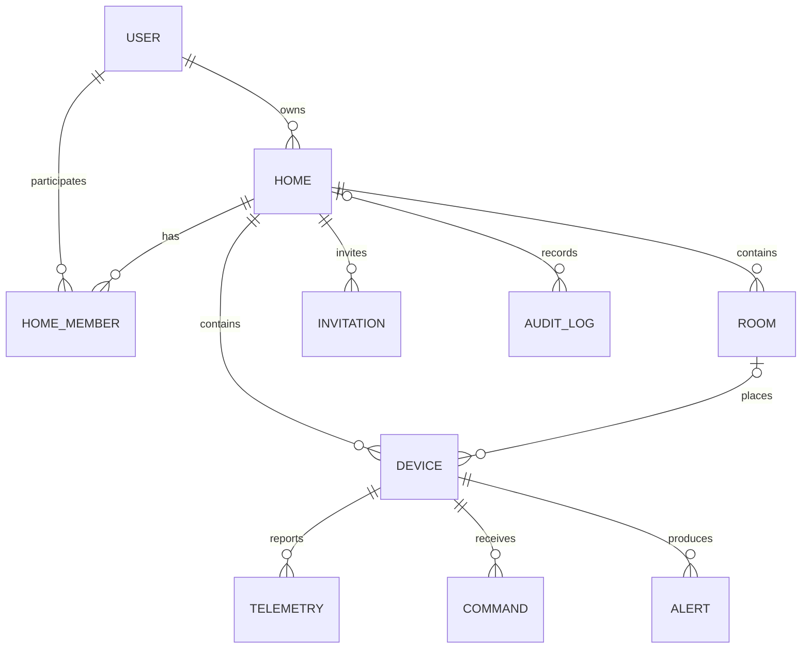

# NODO Home: nhiều nhà, operator và viewer

**Cập nhật phạm vi:** nhóm chỉ làm web desktop. Phần mobile/PWA phía dưới là thiết kế cũ, không còn tính năng hiện hành. Đã bỏ manifest/cài app/thanh điều hướng điện thoại và gỡ worker/cache NODO cũ. Các vai trò dùng web như cũ; nút Đăng xuất ở header hủy session trên server. Điều khiển từ xa và micro dùng trên trình duyệt desktop.

## Mở giao diện

- Admin console: `/` — tài khoản, kho thiết bị, provision/khóa/thu hồi, danh sách nhà và audit lọc theo nhà.
- NODO Home: `/app` — giao diện desktop và điện thoại; đăng nhập operator/viewer tự chuyển đến đây. Admin cũng mở được để giám sát từng nhà.
- Đăng nhập/đăng ký: `/login`. Đăng ký công khai chỉ nhận `operator` hoặc `viewer`; không thể tự đăng ký admin.
- Chưa có xác minh email/OTP hay khôi phục mật khẩu qua email. Lời mời cần đồng thời đúng tài khoản email và mã bí mật được chủ nhà bàn giao; không tự xác nhận danh tính chỉ từ địa chỉ email.
- Operator là chủ nhà. Một tài khoản operator có thể tạo nhiều nhà. Quyền viewer khi tham gia một nhà khác không cho phép điều khiển nhà đó.

## Dữ liệu và quyền

`Home.owner_id` là chủ nhà; `HomeMember(home_id,user_id,role)` lưu vai trò theo nhà. Admin là vai trò toàn hệ thống. Các API xác minh phạm vi nhà tại server, không chỉ ẩn nút trên web. Viewer chỉ xem dữ liệu, trạng thái, lịch sử và cảnh báo; không xem audit chi tiết, sửa phòng, cấu hình hay gửi lệnh.

Thiết bị đã vào nhà kế thừa quyền của nhà; `viewer_ids` cũ không còn cấp quyền cho thiết bị đó. Thu hồi thành viên có hiệu lực ở lần gọi API tiếp theo, kể cả khi tab/websocket vẫn đang mở. Websocket chỉ gửi thông báo cần tải lại, không broadcast dữ liệu cảm biến của tất cả nhà.

## Sử dụng

1. Operator tạo nhà bằng **Cá nhân → Tạo nhà**, đặt tên/địa chỉ tùy chọn.
2. Tạo các phòng; đổi tên phòng không đổi ID và không mất lịch sử. Phòng còn thiết bị phải được chuyển hết thiết bị trước khi xóa.
3. Admin đăng ký node chưa gán chủ → provision → bàn giao tài khoản MQTT cho người nạp firmware. Admin tạo **mã nhận thiết bị** trong chi tiết node. Mã ngẫu nhiên, khác mật khẩu MQTT, chỉ hiển thị lúc tạo, lưu hash, hạn 24 giờ. Device ID/serial một mình không đủ để nhận thiết bị.
4. Operator mở **Thiết bị → Nhận thiết bị**, nhập Device ID, mã và phòng. Node phải provisioned/active, chưa có chủ và chưa thuộc nhà khác. Nhận thành công tiêu thụ mã; không cho claim đè thiết bị của người khác. Admin kích hoạt vòng đời và ESP32 kết nối mới điều khiển được.
5. Đổi tên/chuyển phòng trong cùng nhà ở thẻ thiết bị. Vận hành Auto/Manual, chỉnh ngưỡng, xem lịch sử/CSV tại đây.
6. **Thành viên → Mời viewer**: nhập email. Sao chép link/mã bàn giao qua kênh riêng. Chưa tích hợp gửi email tự động. Người nhận đăng ký/đăng nhập đúng email rồi chấp nhận; mã mời hạn 48 giờ và dùng một lần. Tạo lại lời mời hủy mã cũ; có thể hủy hoặc thu hồi thành viên. Thu hồi chỉ bỏ quyền trong nhà, không xóa tài khoản hệ thống.
7. Điện thoại mở **Cá nhân → Thành viên** để quản lý thành viên; bottom navigation ưu tiên giám sát và điều khiển.

## Auto, Manual và xác nhận

- Auto: firmware dùng ngưỡng đã nhận và lưu bền vững để điều khiển tại node, tiếp tục khi mất mạng. Server kiểm tra cảnh báo ở cả Auto và Manual.
- Manual: operator gửi bật/tắt qua backend. Chỉ gửi khi active, node online, broker kết nối và chưa có lệnh khác đang chờ.
- Lệnh chứa ID, thời điểm gửi, `expiresAt`; timeout 15 giây. MQTT QoS 1 có thể gửi trùng; firmware phải khử trùng theo commandId và từ chối lệnh hết hạn. Không dùng retained cho command/config.
- Giao diện không tự bật công tắc khi vừa gửi lệnh. Chờ application ACK từ đúng node. `failed`, `timeout`, `cancelled` được giữ trong lịch sử. Timeout nghĩa là chưa biết chắc kết quả thực tế, không mặc định rằng thiết bị chưa thực hiện.
- Backend ghi bền vững ACK nhận đúng hạn trước; lưu cấu hình/trạng thái thiết bị rồi mới đánh dấu `applied`. Nếu DB lỗi giữa hai bước, giữ ACK để đối soát lại sau khi DB/server trở lại, không hiển thị thành công trước.
- Chạy một instance backend: khóa theo node hiện nằm trong process. Trước khi scale nhiều replica cần dùng transaction/khóa phân tán và điều phối MQTT consumer.

## Chuyển dữ liệu cũ

Startup tự bổ sung Home/Room cho các node cũ có `owner_id` nhưng chưa có `home_id`. Nhóm node theo người phụ trách, tạo phòng theo `location`, chuyển danh sách `viewer_ids` thành thành viên viewer của nhà. Vì quyền mới tính theo nhà, viewer được chuyển sẽ xem toàn bộ node trong nhà tương ứng. Kiểm tra và thu hồi thành viên không phù hợp trước khi sử dụng dữ liệu thật.

Quy trình bổ sung có thể chạy lại; giữ nguyên user/password, ID thiết bị, telemetry, command, alert và session. Node chưa gán chủ vẫn ở kho admin. Audit cũ không có `home_id` vẫn xem được trong nhật ký toàn hệ thống; audit mới có phạm vi nhà. Chưa hỗ trợ chuyển chủ nhà hay chuyển node đã claim sang nhà khác.

## App điện thoại và truy cập từ xa

Đây là PWA dùng chung Express API, không phải APK/iOS native. Có manifest, icon 192/512, chế độ standalone, safe-area, bottom navigation và service worker. Chỉ cache giao diện công khai; không lưu API, mật khẩu, mã mời, dữ liệu cảm biến hay lệnh trong cache/offline queue.

- Cùng Wi-Fi: chạy `npm.cmd run dev:lan` (hoặc đặt `HOST=0.0.0.0`), mở `http://<IP-LAN-máy-chạy-server>:3080/app` trên điện thoại. Cho phép kết nối port 3080 trong firewall nếu cần. URI localhost trên điện thoại không trỏ về máy tính.
- Từ xa qua 4G/Internet: cần backend chạy liên tục trên server công khai, domain và HTTPS; MQTT broker cũng phải được ESP32 và backend truy cập. MongoDB Atlas không tự cung cấp URL cho ứng dụng Express.
- Cài app trên điện thoại cần HTTPS. Localhost trên máy phát triển là ngoại lệ; IP LAN chạy HTTP chỉ dùng như web bình thường.
- Android: menu Chrome → Cài ứng dụng/Thêm vào màn hình chính. iPhone: Safari → Chia sẻ → Thêm vào Màn hình chính. Có nút hướng dẫn cài trong app.
- Chưa có push notification khi app đã đóng. Cảnh báo cập nhật trong ứng dụng khi đang mở; không mô tả đây là hệ thống báo động khẩn cấp có bảo đảm.

### Triển khai mẫu

Đã có `deployment/Dockerfile`, `.dockerignore`, `deployment/compose.yaml` và Caddy reverse proxy hỗ trợ HTTPS/WebSocket. Cần máy chủ có Docker Compose, domain trỏ đúng IP và cổng 80/443 truy cập được. Chưa tự tạo server/domain hay triển khai ra Internet.

1. Cấu hình `.env` trên server: Atlas URI/database, SESSION_SECRET ngẫu nhiên tối thiểu 32 ký tự, tài khoản bootstrap admin, `SITE_DOMAIN=home.example.com` (thay domain thật).
2. Lần đầu có thể dùng DEMO_MODE=true để kiểm tra giao diện; dữ liệu cảm biến vẫn mô phỏng. Chuyển DEMO_MODE=false khi có broker thật; cấu hình MQTT_URL (`mqtts://...`), username/password và Dynamic Security theo MQTT-CONTRACT. Database demo không tự xóa khi tắt demo; dùng database mới khi triển khai thật.
3. Từ gốc repo chạy `docker compose --env-file .env -f deployment/compose.yaml up -d --build`.
4. Mở `https://<domain>/app`, kiểm tra đăng nhập, `/api/health`, WebSocket, cấu hình/ACK và reconnect bằng phần cứng thật.

Caddy là proxy duy nhất, app không publish port trực tiếp; compose đặt TRUST_PROXY=1 và secure cookie production. Không bật trust proxy khi app trực tiếp nhận request từ Internet. `.env` không được copy vào Docker image hay đưa lên Git.

Tham khảo PWA installability/HTTPS: https://developer.mozilla.org/en-US/docs/Web/Progressive_web_apps/Guides/Making_PWAs_installable

## Kiểm tra

`npm test`: API, phân quyền chéo nhà, viewer, claim, invite, thu hồi, timestamp, dedup, stale/fault và ACK khi lỗi DB; dùng mongod tạm biệt lập, không dùng Atlas thật.

`npm run test:ui`: admin console. `npm run test:home-ui`: operator/viewer desktop/mobile, đăng ký, mời/thu hồi, phòng, claim, config/actuator ACK, CSV, mất mạng/reconnect và kiểm tra cache không chứa API. Screenshot lưu trong `.artifacts/` (ignored).
